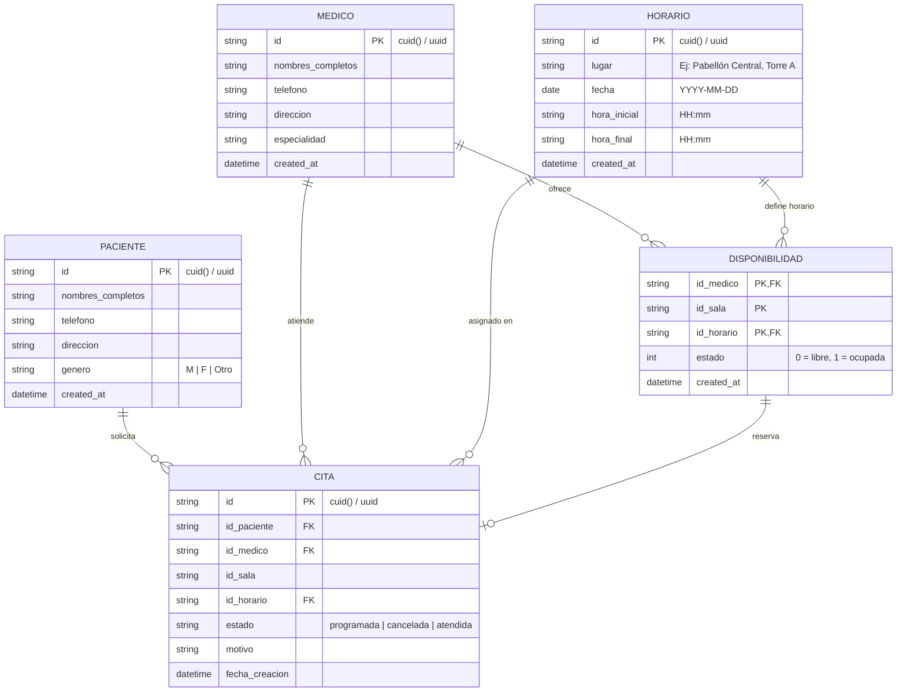

# Diseño de Persistencia: Sistema de Gestión de Citas Médicas

Este documento detalla la arquitectura de datos para el sistema de gestión de citas médicas hospitalarias en sus dos implementaciones: **Relacional (PostgreSQL + Prisma)** y **No Relacional (Firebase Firestore)**, desacopladas mediante el **Patrón Repository**.

---

## 1. Modelo Relacional (PostgreSQL)

### 1.1 Diagrama Entidad-Relación (Mermaid)



### 1.2 Reglas de Integridad y Restricciones Físicas

1. **Clave Primaria Compuesta en `disponibilidad`**:
   $$\text{PK} = (\text{id\_medico}, \text{id\_sala}, \text{id\_horario})$$
2. **Restricción de Médico Único por Horario**:
   - Un médico no puede atender en dos salas al mismo tiempo.
   - `UNIQUE (id_medico, id_horario)`
3. **Restricción de Sala Única por Horario**:
   - Una misma sala física no puede ser ocupada por dos médicos en el mismo horario.
   - `UNIQUE (id_sala, id_horario)`
4. **Relación Foránea e Integridad de Cita**:
   - `CITA` referencia a `(id_medico, id_sala, id_horario)` como FK compuesta hacia `DISPONIBILIDAD` garantizando que la cita apunte a una disponibilidad existente.
5. **Índices de Rendimiento**:
   - Índices en todas las claves foráneas: `idx_disponibilidad_medico`, `idx_disponibilidad_horario`, `idx_cita_paciente`, `idx_cita_medico`.
   - Índice compuesto para búsqueda de turnos libres: `CREATE INDEX idx_disponibilidad_horario_estado ON disponibilidad(id_horario, estado);`
   - Índice para agendas de hoy / fecha: `CREATE INDEX idx_horario_fecha ON horario(fecha);`
6. **Transaccionalidad ACID**:
   - Al agendar cita:
     ```sql
     BEGIN;
     -- Verificar disponibilidad libre
     SELECT estado FROM disponibilidad WHERE id_medico = ... AND id_sala = ... AND id_horario = ... FOR UPDATE;
     -- Si estado = 0:
     UPDATE disponibilidad SET estado = 1 WHERE ...;
     INSERT INTO cita (id, id_paciente, id_medico, id_sala, id_horario, estado, motivo, ...) VALUES (...);
     COMMIT;
     ```
   - Al cancelar cita:
     ```sql
     BEGIN;
     UPDATE cita SET estado = 'cancelada' WHERE id = ...;
     UPDATE disponibilidad SET estado = 0 WHERE id_medico = ... AND id_sala = ... AND id_horario = ...;
     COMMIT;
     ```

---

## 2. Modelo No Relacional (Firebase Firestore)

Firestore es una base de datos documental basada en colecciones y documentos. Para optimizar lecturas masivas y evitar *joins* en tiempo de ejecución (inexistentes en NoSQL), se aplica **desnormalización estratégica**.

### 2.1 Diagrama del Modelo Documental (Mermaid)

```mermaid
classDiagram
    class Medico {
        +string id
        +string nombresCompletos
        +string telefono
        +string direccion
        +string especialidad
        +timestamp createdAt
    }

    class Paciente {
        +string id
        +string nombresCompletos
        +string telefono
        +string direccion
        +string genero
        +timestamp createdAt
    }

    class Horario {
        +string id
        +string lugar
        +string fecha "YYYY-MM-DD"
        +string horaInicial "HH:mm"
        +string horaFinal "HH:mm"
        +timestamp createdAt
    }

    class Disponibilidad {
        +string id "{medicoId}_{salaId}_{horarioId}"
        +string medicoId
        +string medicoNombre
        +string especialidad
        +string salaId
        +string horarioId
        +string lugar
        +string fecha "YYYY-MM-DD"
        +string horaInicial "HH:mm"
        +string horaFinal "HH:mm"
        +number estado "0: libre, 1: ocupada"
        +timestamp updatedAt
    }

    class Cita {
        +string id
        +string pacienteId
        +string pacienteNombre
        +string pacienteTelefono
        +string medicoId
        +string medicoNombre
        +string especialidad
        +string salaId
        +string horarioId
        +string fecha "YYYY-MM-DD"
        +string horaInicial "HH:mm"
        +string horaFinal "HH:mm"
        +string estado "programada | cancelada | atendida"
        +string motivo
        +timestamp fechaCreacion
    }

    Medico "1" ..> "N" Disponibilidad : Datos incrustados
    Horario "1" ..> "N" Disponibilidad : Datos incrustados
    Paciente "1" ..> "N" Cita : Datos incrustados
    Disponibilidad "1" <..> "1" Cita : Transacción atómica
```

### 2.2 Estrategia de Colecciones e Índices

1. **ID Determinístico para Concurrencia de Disponibilidad**:
   - El documento en `disponibilidades` tiene como ID:
     `docId = "${medicoId}_${salaId}_${horarioId}"`
   - Esto previene automáticamente duplicados físicos sin necesidad de un lock distribuido.
   - Además, para validar que ni el médico ni la sala se solapen en el mismo `horarioId`, se consulta antes de crear la disponibilidad o se indexan las duplas `(medicoId, horarioId)` y `(salaId, horarioId)`.

2. **Desnormalización de `disponibilidades` y `citas`**:
   - `disponibilidades` contiene `medicoNombre`, `especialidad`, `fecha`, `horaInicial`, `horaFinal`.
   - Permite consultas directas con un solo query:
     ```typescript
     firestore.collection('disponibilidades')
       .where('estado', '==', 0)
       .where('especialidad', '==', 'Cardiología')
       .where('fecha', '==', '2026-11-15')
       .orderBy('horaInicial');
     ```
   - No requiere uniones ni 3 lecturas secuenciales.

3. **Transacciones Atómicas con `runTransaction`**:
   - Agendar cita:
     ```typescript
     await db.runTransaction(async (transaction) => {
       const dispRef = db.collection('disponibilidades').doc(dispDocId);
       const dispDoc = await transaction.get(dispRef);
       if (!dispDoc.exists || dispDoc.data()?.estado !== 0) {
         throw new Error('La disponibilidad ya no se encuentra libre.');
       }
       const citaRef = db.collection('citas').doc();
       transaction.update(dispRef, { estado: 1, updatedAt: new Date() });
       transaction.set(citaRef, { ...citaData, estado: 'programada', fechaCreacion: new Date() });
     });
     ```
   - Cancelar cita:
     ```typescript
     await db.runTransaction(async (transaction) => {
       const citaRef = db.collection('citas').doc(citaId);
       const citaDoc = await transaction.get(citaRef);
       const data = citaDoc.data();
       const dispDocId = `${data.medicoId}_${data.salaId}_${data.horarioId}`;
       const dispRef = db.collection('disponibilidades').doc(dispDocId);

       transaction.update(citaRef, { estado: 'cancelada' });
       transaction.update(dispRef, { estado: 0, updatedAt: new Date() });
     });
     ```

4. **Índices Compuestos Requeridos (`firestore.indexes.json`)**:
   - `disponibilidades`: `estado` (ASC), `especialidad` (ASC), `fecha` (ASC), `horaInicial` (ASC)
   - `disponibilidades`: `estado` (ASC), `medicoId` (ASC), `fecha` (ASC)
   - `citas`: `fecha` (ASC), `estado` (ASC)
   - `citas`: `medicoId` (ASC), `fecha` (ASC)

---

## 3. Tabla Comparativa: Relacional vs. No Relacional

| Criterio | Versión Relacional (PostgreSQL + Prisma) | Versión No Relacional (Firebase Firestore) |
| :--- | :--- | :--- |
| **Paradigma** | Tablas normalizadas (3NF) con claves foráneas. | Documentos JSON planos con datos desnormalizados. |
| **Modelado de Relaciones** | Claves primarias compuestas y FK explícitas (`ON DELETE RESTRICT`). | Referencias por ID y copias embebidas de campos clave (nombres, fechas). |
| **Integridad de Datos** | **Estricta por motor**: el RDBMS rechaza violaciones de unicidad o FK huérfanas mediante constraints (`UNIQUE`, `CHECK`). | **A nivel de aplicación / transaccional**: la unicidad se garantiza mediante IDs determinísticos y `runTransaction`. |
| **Consultas de Búsqueda** | Requiere `JOIN` entre `disponibilidad`, `medico` y `horario`. | **Directa y ultra-rápida**: un solo `collection.where(...)` sin uniones. |
| **Duplicación de Datos** | **Cero duplicación**: si un médico cambia su nombre, solo se actualiza en la tabla `medico`. | **Duplicación intencional**: `medicoNombre` se replica en disponibilidad y cita para máxima velocidad de lectura. |
| **Escalabilidad** | Escalabilidad vertical típica; horizontal mediante réplicas de lectura y sharding complejo. | **Escalabilidad horizontal nativa**: particionamiento automático de Google Cloud sin mantenimiento. |
| **Costos / Facturación** | Costo por capacidad de cómputo y almacenamiento del servidor (instancia fija o serverless compute hours). | Costo por operaciones atómicas (número de lecturas, escrituras y eliminaciones). |
| **Transacciones de Reserva** | Transacción ACID tradicional (`BEGIN ... SELECT FOR UPDATE ... COMMIT`). Bloqueo pesimista u optimista. | Control de concurrencia optimista (OCC) en `runTransaction` de Firestore (reintenta si el documento cambió). |

---

## 4. Patrón Repository y Arquitectura de Software

Para desacoplar la interfaz y la lógica de negocio de la base de datos subyacente, la aplicación implementa el **Patrón Repository**:

```
[UI: Pages & Components (Next.js App Router)]
                 │
                 ▼
[Action Handlers / API Routes / Services (Casos de Uso)]
                 │
                 ▼
[Domain Interfaces: MedicoRepository, CitaRepository, etc.]
                 ▲
        ┌────────┴────────┐
        │                 │
[PrismaRepository]  [FirestoreRepository]
(PostgreSQL)         (Firebase Cloud)
        │                 │
  DB_PROVIDER=postgres  DB_PROVIDER=firestore
```

### Interfaces Centrales:
- `MedicoRepository`: `findAll()`, `findById()`, `create()`, `update()`, `delete()`, `findByEspecialidad()`
- `PacienteRepository`: `findAll()`, `findById()`, `create()`, `update()`, `delete()`
- `HorarioRepository`: `findAll()`, `findById()`, `create()`, `update()`, `delete()`, `findByFecha()`
- `DisponibilidadRepository`: `findAll()`, `findLibres(filtro)`, `create()`, `delete()`, `checkConflicto()`
- `CitaRepository`: `findAll(filtro)`, `findById()`, `crearConTransaccion()`, `cancelarConTransaccion()`, `cambiarEstado()`
- `DashboardRepository`: `getMetricas()`

El proveedor se selecciona mediante una factoría unificada:
```typescript
// src/lib/repositories/factory.ts
const provider = process.env.DB_PROVIDER || 'postgres';
export const getRepositoryContainer = () => {
  return provider === 'firestore' ? firestoreContainer : prismaContainer;
};
```
Esto asegura que **el 100% de la UI y los endpoints de Next.js permanezcan intactos** al alternar entre bases de datos.
